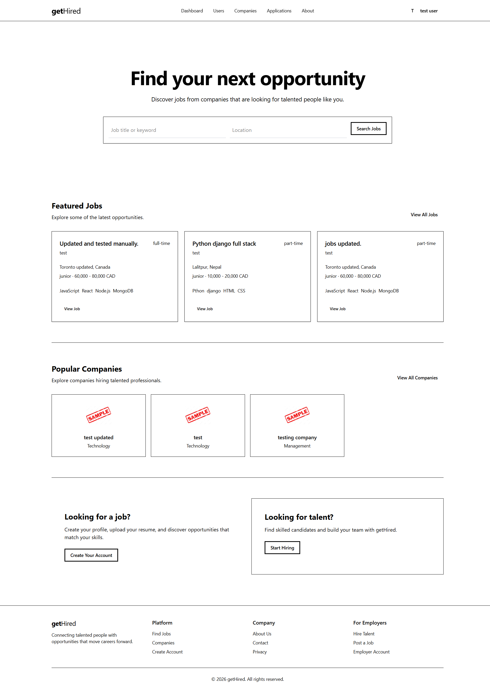
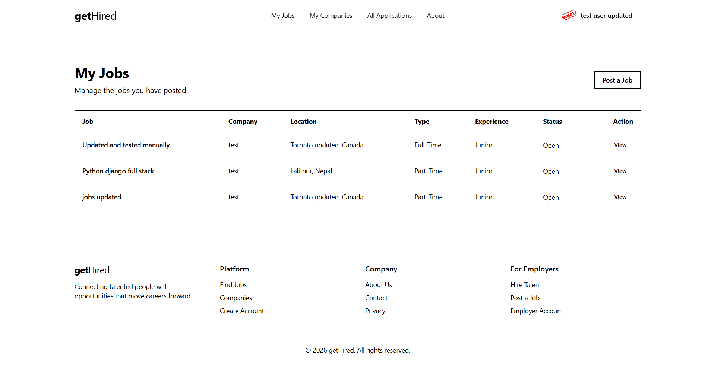
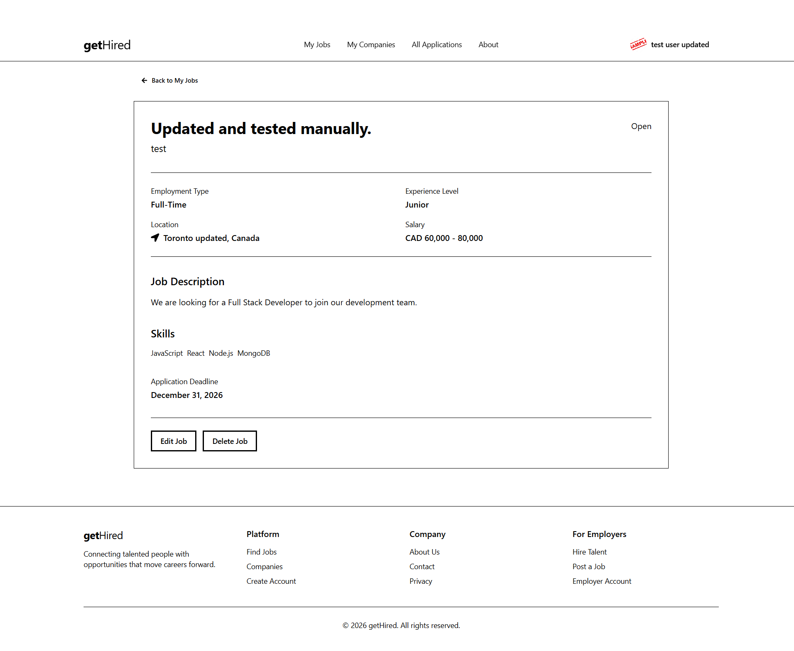
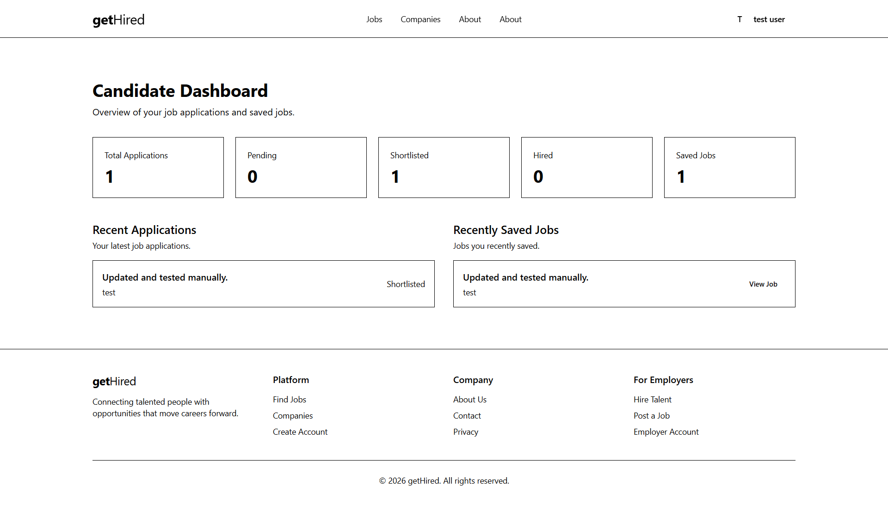
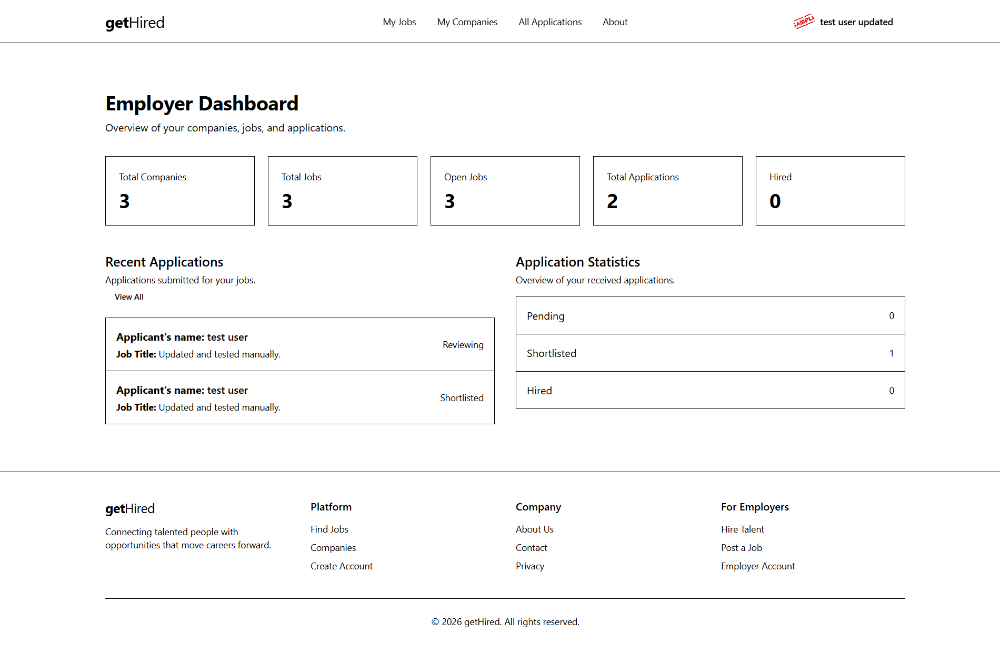
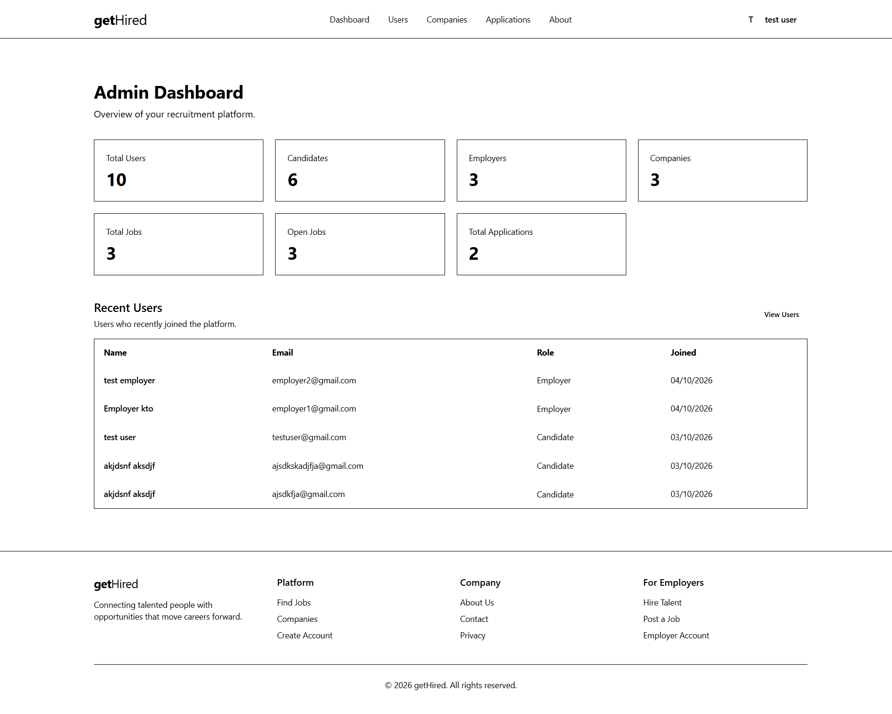

# getHired

A simple job platform, like a small version of Indeed or LinkedIn Jobs. Job seekers find and apply for jobs. Recruiters post jobs and manage applicants. Admins keep the platform clean.



## Screenshots


| Home                                   | Jobs                                 | Job Details                                        |
| -------------------------------------- | ------------------------------------ | -------------------------------------------------- |
|  |  |  |

### Dashboards

| Candidate                                                          | Employer                                                          | Admin                                                      |
| ------------------------------------------------------------------ | ----------------------------------------------------------------- | ---------------------------------------------------------- |
|  |  |  |

## What can each user do?

**Job Seeker**
- Sign up and log in
- Create a profile and upload a resume
- Search and filter jobs
- Apply, withdraw, and track application status
- Save jobs for later

**Recruiter**
- Sign up and log in
- Create a company profile
- Post, edit, and delete jobs
- See applicants and their resumes
- Update application status (Applied, Reviewing, Shortlisted, Rejected, Hired)

**Admin**
- View users, companies, and jobs
- Disable or delete users
- Remove bad job posts

## Tech Stack

- **Frontend:** React, Redux Toolkit, Vanilla CSS
- **Backend:** Node.js, Express
- **Database:** MongoDB (Mongoose)
- **Login:** JWT + cookies
- **File uploads:** Multer + Cloudinary

## Main Data (MongoDB)

- **User**: name, email, password, role, profile, isActive
- **Company**: name, description, logo, website, location, recruiter
- **Job**: title, description, skills, salary, location, jobType, experienceLevel, company
- **Application**: job, applicant, resume, coverLetter, status

## Folder Structure

```
getHired/
├── backend/   (Express API: models, routes, controllers, middleware)
└── frontend/  (React app: pages, components, features, redux)
```

## How to Run

```bash
# Get the code
git clone https://github.com/sujan7neupane/getHired.git
cd getHired

# Start the backend
cd backend
npm install
npm run dev

# Start the frontend (in a new terminal)
cd frontend
npm install
npm run dev
```

## Environment Variables

Create a `.env` file in `backend/`:

```
PORT=5000
BACKEND_URI=your_mongodb_link
NODE_ENV="development"
JWT_SECRET=your_secret
CLOUDINARY_CLOUD_NAME=your_name
CLOUDINARY_API_KEY=your_key
CLOUDINARY_API_SECRET=your_secret
```

## Plan

1. Project setup
2. Login and register
3. User profile
4. Companies
5. Jobs (search, filters, pagination)
6. Applications
7. Saved jobs
8. Admin tools
9. Dashboards

## Not Included (for now)

Payments, chat, AI matching, Docker, and other advanced stuff. We'll keep it simple first.
Job filterm search and pagination